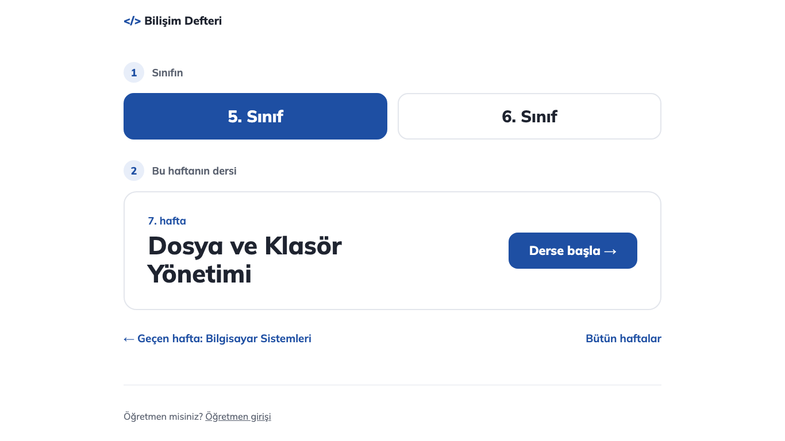
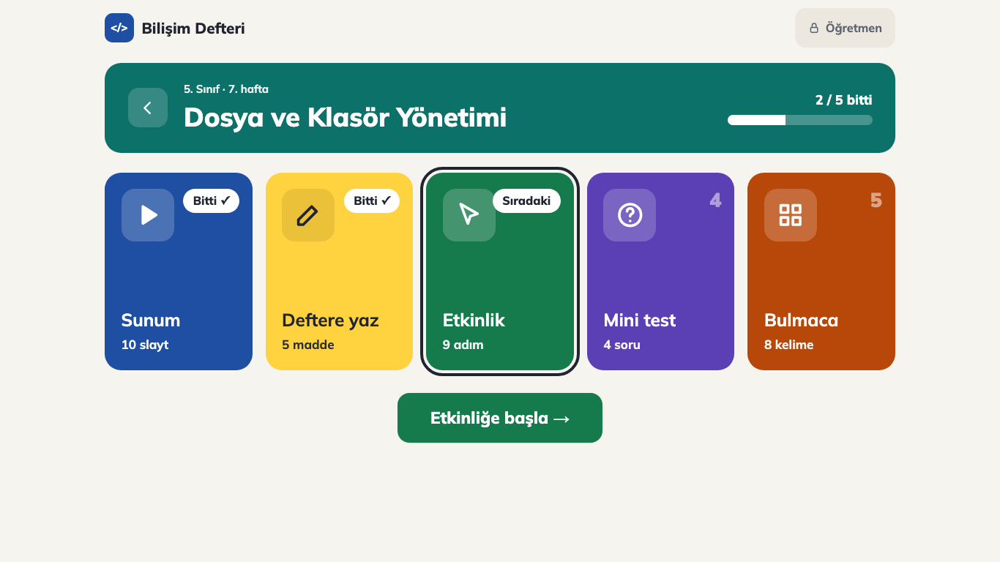
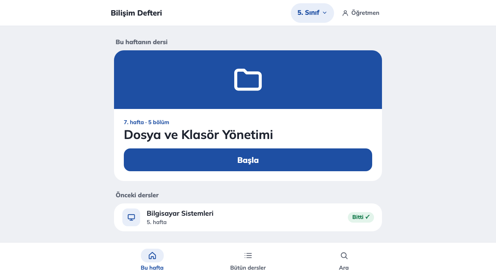

# Tasarım seçenekleri (mockup)

Sitenin daha sade, kart tabanlı bir tasarıma geçmesi için üç yön. Siteye dokunulmadı, bunlar statik örneklerdir. Tıklanınca sadece ana sayfadan ders sayfasına geçilir, gerisi çalışmaz.

**Nasıl bakılır:** `mockups/index.html` dosyasına çift tıklayın. Bütün ekran görüntüleri orada yan yana. Her yönün kendi sayfaları `a-sade/`, `b-renkli/` ve `c-uygulama/` klasörlerinde.

Görüntüler `ekran/` klasöründe, iki boyutta: 1366×768 (okul bilgisayarı) ve 1920×1080 (tahta). Karşılaştırma için sitenin şu anki öğrenci görünümü de var (`mevcut-*.png`).

Hepsinde ortak olanlar:
- Gömülü Mulish yazı tipi (`../assets/mulish.css`).
- İkonlar satır içi SVG. Emoji kullanılmadı, çünkü Pardus'ta renkli emoji yazı tipi olmayabilir.
- Gölge ve gradyan yok, sadece açık tema.
- Bütün düğmeler en az 48 px.
- CSS Chrome 84 ile uyumlu.

## Mevcut tasarımda öğrenciyi zorlayanlar

### Ana sayfa (`#sinif-5` de bu sayfayı açar)
- **Çok uzun liste:** Ekranda 18 satırlık bir hafta listesi var ve 16 satır "Yakında" diye soluk duruyor. Öğrencinin işine yarayan 2 satır kalabalıkta kayboluyor.
- **"Bu hafta" yok:** Öğrenci listede kendi haftasını kendisi arıyor. "Kaldığın yer" kartı sadece daha önce bir ders açıldıysa çıkıyor.
- **Derse 3 tıkta ulaşılıyor:** Sınıf seçilir, hafta satırı açılır, sonra "Derse gir" düğmesine basılır. Satırın açılabildiği sadece küçük bir üçgenden anlaşılıyor.
- **"1. dönem / 2. dönem":** Bu ayrım açılır kapanır bir bölüm olarak geliyor. 10 yaşındaki bir çocuk için gereksiz bir kavram.
- **Üst bantta "Rol: Öğrenci" düğmesi:** Ne işe yaradığı belli değil. Tek tıkla öğretmen görünümüne geçiriyor.
- **Arama kutusu:** Bantta çok yer kaplıyor, öğrencinin buna ihtiyacı az.
- **Küçük yazılar:** "Hazır" ve "Yakında" etiketleri yaklaşık 13 px. Alttaki künye yazısı uzun.

### Ders sayfası
- **Tekrarlanan bilgi:** "5. Sınıf · 7. Hafta" üç kez yazıyor (yol bilgisi, etiket, slayt). Sekme adı da hemen altında başlık olarak tekrar ediyor ("Sunum" sekmesi, altında "Sunum" başlığı ve açıklaması).
- **Çok fazla slayt düğmesi:** Slayt çubuğunda 14 kontrol var (Önceki, sayaç, Sonraki, 10 nokta, Tam ekran). Noktalar 24 px, dokunmak için küçük.
- **Öğretmen öğeleri öğrencide görünüyor:**
  - Slaytların köşesinde "süreç bileşeni a" yazıyor.
  - Etkinlik sekmesinde "Laboratuvar" ortam etiketi çıkıyor.
- **Ekranda öğretmen için yazılmış metinler:**
  - "Derse başlarken" kutusu: öğretmenin sınıfa sorduğu soru, öğrencinin okuması gerekmiyor.
  - "Slayta tıklayıp ← → ok tuşlarıyla geçebilirsin. Tam ekrandan Esc ile çıkılır." ipucu: küçük yazıyla duruyor.
- **Etkinlik sekmesi çok uzun:** Bilgi kartları, hedef, gerekenler, işletim sistemi satırlarıyla 9 adım ve kapalı bir sınıflandırma oyunu aynı sayfada.
- **İki ayrı alt düğme:** Sayfanın altında hem "Sonraki bölüm" hem "← 5. Sınıf dersleri" var.

### Öğretmen Masası
- Öğrenci buraya giremiyor, bu iyi. Ama girişin üst banttaki "Rol" düğmesi olduğu için ayrım zayıf.
- Ayar kartlarındaki açıklamalar küçük yazıyla 2–3 satır. Öğretmen için sorun değil, öğrenciye etkisi yok.

## A) Çok sade

Beyaz zemin, tek vurgu rengi (lacivert), büyük yazı. Ana sayfada sadece iki adım var: "1 Sınıfın" ve "2 Bu haftanın dersi". Ders sayfasında 5 bölüm düz bir çizgide duruyor. Slaytta sadece "Önceki" ve "Sonraki" düğmeleri var.

- **Güçlü yanlar:**
  - En az öğe, en kolay okunan sayfa.
  - Mevcut renkler ve yazı tipi korunduğu için siteye geçişi en ucuz yön.
  - Tahtada ve soluk projeksiyonda en iyi okunan yön.
- **Zayıf yanlar:**
  - 10–12 yaşa biraz "resmî" ve soğuk gelebilir.
  - Her şey aynı renkte olduğu için bölümler birbirinden renkle ayrılmıyor.

## B) Renkli kartlar

- **Renkler:** Her sınıfın kendi rengi var (5 lacivert, 6 kiremit). Haftanın kartı temanın renginde. Ders sayfasında her bölüm kendi renginde, ikonlu büyük bir kart: Sunum, Defter, Etkinlik, Test, Bulmaca.
- **İlerleme:** "Bitti ✓" ve "Sıradaki" rozetleri ile bir ilerleme çubuğu var.

- **Güçlü yanlar:**
  - Çocuklara en sıcak gelen yön.
  - Bölümler renkten tanınıyor ("yeşil kart = etkinlik").
  - Ne yapıldığı ve sırada ne olduğu tek bakışta görülüyor.
- **Zayıf yanlar:**
  - **Uygulaması en ağır yön:** Ders sayfasına ayrı bir "bölüm seçme" ekranı ekleniyor, yani her bölüm için bir tık daha gerekiyor. 6 tema rengi ve 5 bölüm rengi bakım ister.
  - **Kontrast ve renk körlüğü:** Renk çok olunca kontrastı korumak zorlaşıyor. Sarı kartta yazı koyu olmak zorunda. Renk körü öğrenciler için rozet yazıları şart.

## C) Uygulama gibi

- **Çerçeve:** Üstte uygulama çubuğu var. Sınıf burada "5. Sınıf ▾" düğmesiyle seçiliyor, "Öğretmen" girişi de sağda.
- **Gezinme:** Altta sabit sekme çubuğu var: Bu hafta, Bütün dersler, Ara. Ders sayfasında alt çubuk dersin 5 bölümüne dönüşüyor.
- **Yerleşim:** İçerik tablet genişliğinde tek bir sütunda.

- **Güçlü yanlar:**
  - Telefon ve tabletten tanıdık bir düzen.
  - Bölümler arası geçiş hep aynı yerde, ekranın altında.
  - Etkileşimli tahtada alt çubuk öğrencinin boyuna yakın.
  - Ders sayfasında slayta en çok yer kalıyor.
- **Zayıf yanlar:**
  - **Boş kenarlar:** 1366 ve 1920 px'te sütun dar kalıyor, ekranın yarısı boş.
  - **Kırılgan yerleşim:** Sabit üst ve alt çubuklar küçük yüksekliklerde ve A+ büyük yazı modunda içeriğe yer bırakmayabilir.
  - **Yazdırma:** Çalışma kâğıdı sayfasında çubukların ayrıca gizlenmesi gerekir.
  - **Gizli sınıf değişimi:** Sınıf açılır bir düğmede durduğu için ilk kez gelen öğrenci onu fark etmeyebilir. İlk açılışta tam ekran bir sınıf seçimi gerekir.

## Hangisi seçilirse seçilsin

- **"Bu haftanın dersi":** Site şu an hangi haftada olunduğunu bilmiyor ("Bu hafta" ayarı 2026-11-01'de kaldırıldı). Üç yön de bunu istiyor. Öğretmen Masası'na dönem başlangıç tarihi ya da "şu anki hafta" ayarı eklenmesi gerekir.
- **Öğretmen girişi:** Üç yönde de öğretmen girişi öğrenci akışının dışında duruyor (A'da sayfanın altında, B ve C'de sağ üstte). Şifre yok, mevcut rol ayrımıyla aynı mantık.
